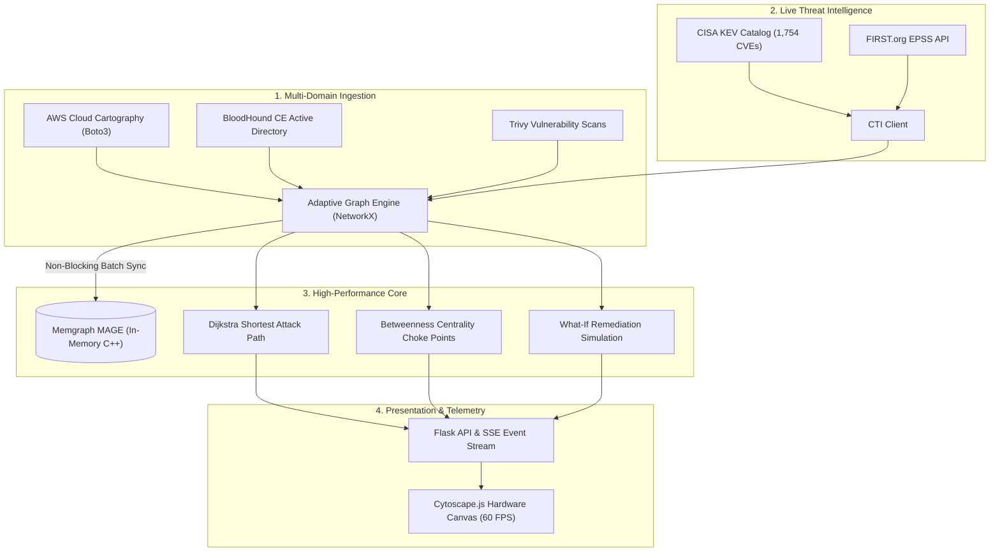

#  AegisPath Enterprise

**Next-Generation Adaptive Attack Path Management (APM) & Multi-Cloud Cyber Threat Intelligence Engine**  
*100% Free & Open-Source Software (FOSS) — Built on Memgraph MAGE, Redpanda, NetworkX, and Boto3.*

[](https://opensource.org/licenses/Apache-2.0)
[](https://www.python.org/downloads/)
[](https://docs.docker.com/compose/)
[](https://memgraph.com/)
[](https://redpanda.com/)

---

##  Executive Summary

Legacy vulnerability scanners report thousands of isolated vulnerabilities without operational context. Security leaders need to answer a single question:  
> *"Can an external attacker reach our Domain Controllers or customer databases from the outside right now?"*

**AegisPath Enterprise** eliminates the guesswork by dynamically correlating:
1. **Live Cloud Cartography** (AWS Boto3: EC2, Security Groups, IAM Roles, S3, RDS).
2. **Active Directory Privilege Escalation Graphs** (BloodHound CE / SharpHound: ACEs, Nested Groups, Domain Trusts, DCSync).
3. **Container Vulnerability Reports** (Trivy / Grype JSON scans).
4. **Real-World Threat Intelligence** (Live FIRST.org EPSS scores and CISA Known Exploited Vulnerabilities catalog).
5. **Dynamic Graph Algorithms** (Dijkstra weighted by inverse traversability $W = 1/\text{Traversability}$, and Betweenness Centrality for choke-point discovery).

---

##  Architecture Overview



---

##  Key Innovations

- **Dynamic Inverse Traversability**: Attack path resistance is computed as:
  $$\text{Weight}(u, v) = \frac{1}{\text{Traversability}(u, v)}$$
  Exploited CVEs and compromised footholds reduce resistance, immediately pulling the critical attack path through breached assets.
- **Topological Choke Points (Min-Cut)**: Identifies cut-vertices using Betweenness Centrality on the active attack subgraph, pinpointing the single asset or role that severs the maximum number of breach paths.
- **"What-If" Remediation Simulation**: Calculates the exact percentage reduction in breach exposure *before* changes are deployed to production.
- **Dynamic Tier-0 Designation**: Operators can click any node in the visual inspector and toggle Crown Jewel status on the fly.
- **Sub-Graph Projection**: Avoids browser DOM freezing on dense graphs (1,500+ edges) by projecting the 20–44 node active attack subgraph with hardware-accelerated Cytoscape rendering.
- **Zero Mock Policy**: 100% authentic infrastructure data. Clean zero-baseline initialization.

---

##  Quickstart Guide

### 1. Prerequisites
- [Docker Desktop](https://www.docker.com/) (running)
- [Python 3.10+](https://www.python.org/)

### 2. Clone & Install
```bash
git clone https://github.com/genre-tech/aegispath.git
cd aegispath
pip install -r requirements.txt
```

### 3. Launch Backend Infrastructure (Docker)
```bash
docker compose up -d
```
This spins up:
- **Memgraph MAGE**: `bolt://localhost:7687` (Graph Database)
- **Memgraph Lab**: `http://localhost:3000` (Visual Query Explorer)
- **Redpanda**: `localhost:19092` (Kafka Event Stream)
- **Redpanda Console**: `http://localhost:8080` (Event Dashboard)

### 4. Start the AegisPath Server
```bash
python server.py
```
Open **`http://localhost:8081`** in your browser.

---

##  Ingestion Workflows

### A. AWS Cloud Discovery (Read-Only)
1. Open the **Ingestion Hub** (` Ingestion Hub`).
2. Select **AWS Cloud Discovery**.
3. Input your AWS Access Key, Secret Key, and Region (e.g. `us-east-1` or `ap-southeast-2`).
4. Click **Connect & Run Cloud Discovery**. The engine automatically normalizes Availability Zones and maps EC2 hosts, Security Groups, IAM Roles, S3 buckets, and RDS instances.

### B. Active Directory (BloodHound CE)
1. In the **Ingestion Hub**, select **BloodHound AD**.
2. Specify your collection folder path (or paste raw JSON).
3. Select your target domain and click **Ingest AD Folder Data**.
4. The engine maps nested groups, Access Control Entries (`GenericAll`, `WriteDacl`, `AddMember`), sessions, and Domain Controllers (`DC01`).

### C. Vulnerability Scanners (Trivy / CVE)
1. In the **Ingestion Hub**, select **Vulnerability Enrichment**.
2. Enter the target host ID (e.g. `i-0123...`) and the CVE identifier (e.g. `CVE-2024-21626`).
3. Click **Enrich & Ingest CVE**. The engine queries FIRST.org EPSS and the CISA KEV catalog in real time.

---

##  REST API Reference

| Method | Endpoint | Description |
| :--- | :--- | :--- |
| `GET` | `/api/graph?mode=paths` | Returns active attack path subgraph (or `mode=all` for full topology). |
| `GET` | `/api/paths` | Evaluates all paths to Crown Jewels sorted by breach probability. |
| `GET` | `/api/chokepoints` | Computes betweenness centrality and remediation recommendations. |
| `POST`| `/api/node/toggle-crown-jewel`| Toggles Tier-0 Crown Jewel status on any node. |
| `POST`| `/api/simulate/sever` | Simulates the removal of a choke point and returns risk reduction metrics. |
| `POST`| `/api/ingest/aws/live` | Connects to AWS via Boto3 session. |
| `POST`| `/api/ingest/bloodhound/directory` | Ingests BloodHound CE collection files from disk. |
| `POST`| `/api/ingest/cve` | Associates and enriches a CVE on an asset. |
| `GET` | `/api/events` | Real-time Server-Sent Events (SSE) stream for UI reactivity. |

---

##  License

Distributed under the Apache 2.0 License. See `LICENSE` for more information.
