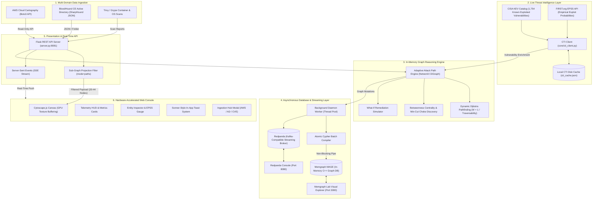
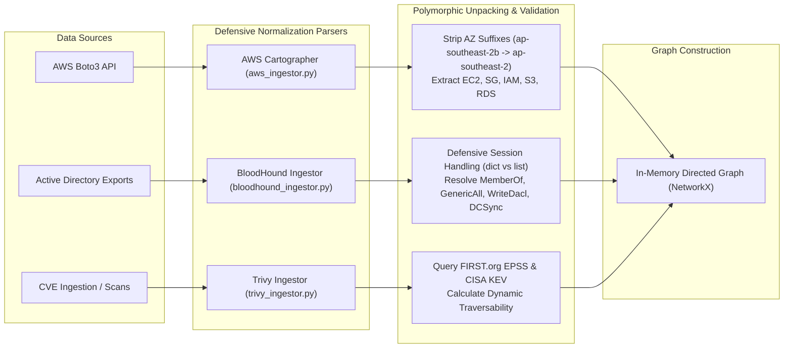
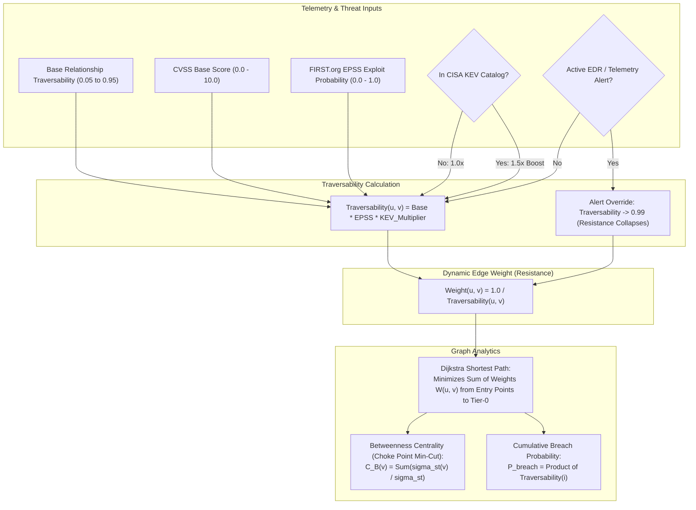
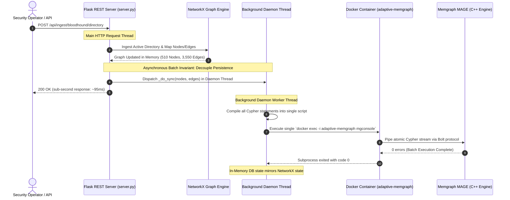
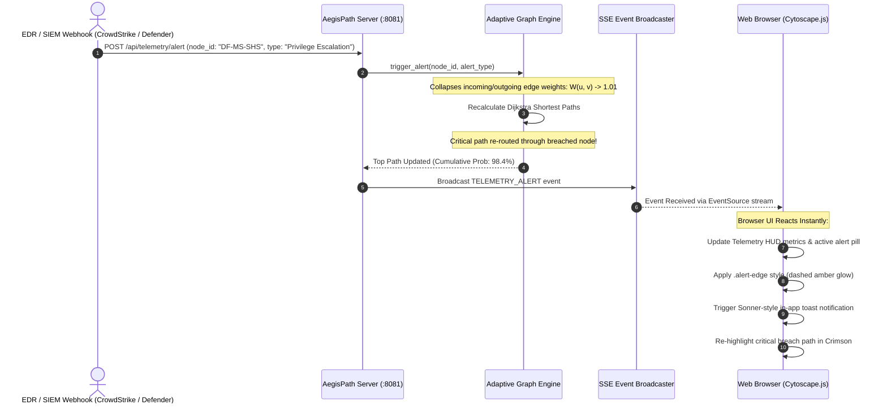
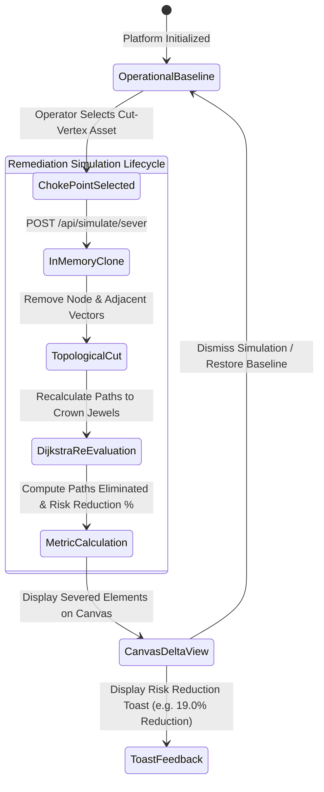
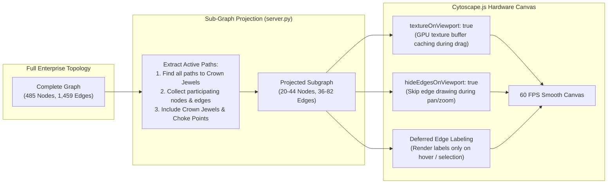
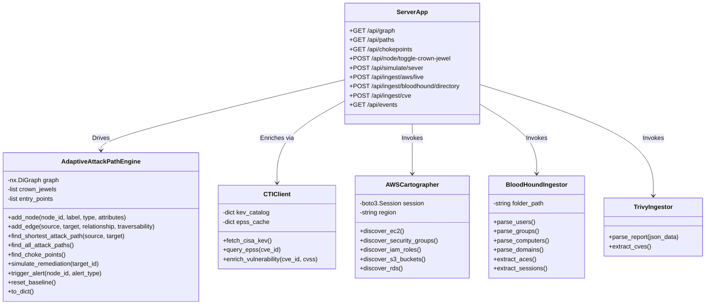

# 📐 AegisPath Enterprise: System Architecture & Diagram Suite

A comprehensive architectural and engineering diagram suite for **AegisPath Enterprise** (Adaptive Attack Path Management & Multi-Cloud Cyber Threat Intelligence Engine).

---

## Table of Contents
1. [End-to-End System Architecture](#1-end-to-end-system-architecture)
2. [Multi-Domain Ingestion & Normalization Pipeline](#2-multi-domain-ingestion--normalization-pipeline)
3. [Mathematical Graph Reasoning & Pathfinding Model](#3-mathematical-graph-reasoning--pathfinding-model)
4. [Asynchronous Batch Database Synchronization Architecture](#4-asynchronous-batch-database-synchronization-architecture)
5. [Real-Time Telemetry & EDR Alert Recalibration Flow](#5-real-time-telemetry--edr-alert-recalibration-flow)
6. [What-If Remediation Simulation Engine](#6-what-if-remediation-simulation-engine)
7. [Sub-Graph Projection & Hardware-Accelerated Canvas Pipeline](#7-sub-graph-projection--hardware-accelerated-canvas-pipeline)
8. [Database & Entity Relationship Schema (ERD)](#8-database--entity-relationship-schema-erd)
9. [Component Class & Module Hierarchy](#9-component-class--module-hierarchy)

---

## 1. End-to-End System Architecture

High-level architecture showing ingestion boundaries, live threat intelligence feeds, graph computation, async persistence, and real-time streaming presentation.



---

## 2. Multi-Domain Ingestion & Normalization Pipeline

Detailed data normalization workflow across AWS Boto3 cloud assets, BloodHound Active Directory graphs, and container vulnerability scans.



---

## 3. Mathematical Graph Reasoning & Pathfinding Model

The dynamic inverse exploitability model where real threats reduce edge resistance and pull Dijkstra's shortest path toward compromised assets.



---

## 4. Asynchronous Batch Database Synchronization Architecture

Sequence diagram showing how in-memory mutations are batched into atomic Cypher streams and decoupled to background daemon worker threads to keep user-facing APIs responsive (<100ms).



---

## 5. Real-Time Telemetry & EDR Alert Recalibration Flow

Sequence diagram illustrating real-world incident response: when an EDR alert fires, edge friction collapses, the critical path reroutes instantly, and connected browsers update live via Server-Sent Events (SSE).



---

## 6. "What-If" Remediation Simulation Engine

State machine diagram showing the non-destructive simulation lifecycle when evaluating choke point remediation.



---

## 7. Sub-Graph Projection & Hardware-Accelerated Canvas Pipeline

Pipeline diagram showing how dense topologies (1,500+ edges) are filtered down to the active attack sub-graph (20–44 nodes) and rendered at 60 FPS using GPU texture buffering.



---

## 8. Database & Entity Relationship Schema (ERD)

The graph data model detailing node labels, attributes, and relationship vectors.

```mermaid
erDiagram
    Perimeter ||--o{ Host : EXPOSES
    Host ||--o{ SecurityGroup : PROTECTED_BY
    Host ||--o{ IAMRole : ASSUMES_ROLE
    Host ||--o{ Vulnerability : HAS_VULNERABILITY
    IAMRole ||--o{ CrownJewel : HAS_ACCESS
    
    Identity ||--o{ Identity : MEMBER_OF
    Identity ||--o{ Identity : GENERIC_ALL
    Identity ||--o{ Identity : WRITE_DACL
    Identity ||--o{ Host : ADMIN_TO
    Identity ||--o{ Host : HAS_SESSION
    Identity ||--o{ CrownJewel : DCSYNC
    
    Perimeter {
        string id PK "internet"
        string label "Public Internet"
        boolean is_entry_point true
    }

    Host {
        string id PK "Instance ID / Hostname"
        string label "Display Name"
        string type "Host"
        string ip_address "IPv4 Address"
        string os "Operating System"
        string domain "Domain Name"
    }

    SecurityGroup {
        string id PK "sg-xxxx"
        string label "SG Name"
        string inbound_rules "Port Ranges (e.g. 22, 80, 443, 3389)"
    }

    IAMRole {
        string id PK "Role ARN"
        string label "Role Name"
        string policy_type "Admin / ReadOnly"
    }

    Identity {
        string id PK "Object SID (S-1-5-...)"
        string label "Account Name"
        string type "User / Group / Computer"
        boolean is_admin "High Privilege Flag"
    }

    Vulnerability {
        string id PK "CVE-YYYY-XXXXX"
        float cvss "CVSS Base Score"
        float epss "EPSS Probability"
        boolean in_cisa_kev "CISA KEV Catalog Presence"
    }

    CrownJewel {
        string id PK "Target Asset ID"
        string label "Domain Controller / DB"
        string tier "Tier-0"
        boolean is_crown_jewel true
    }
```

---

## 9. Component Class & Module Hierarchy

Object-oriented component hierarchy implementing clean architecture across the engine, CTI client, ingestors, and REST API.


